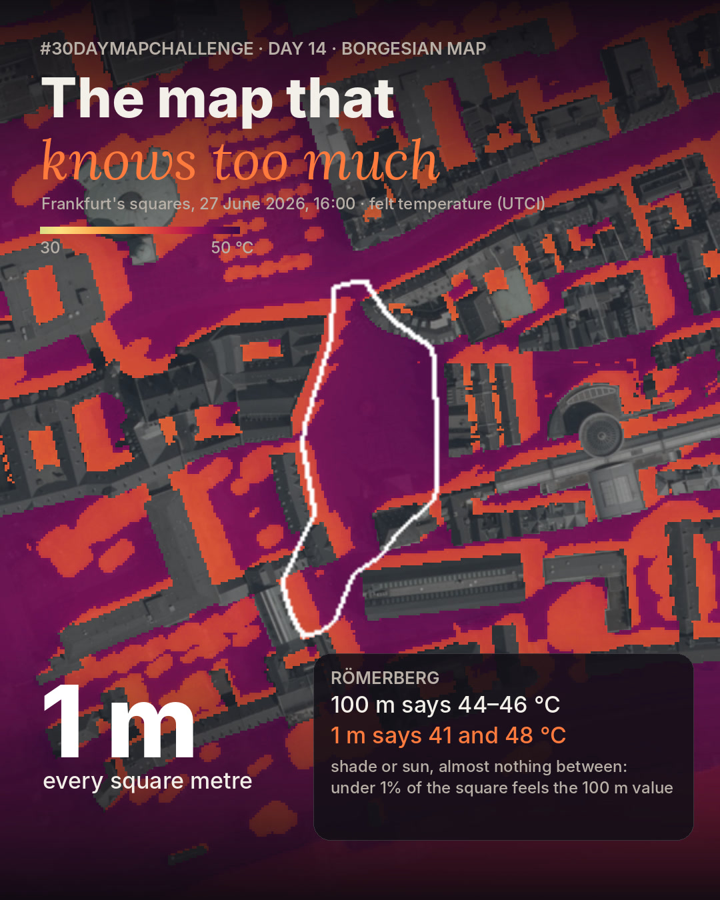

# The Map That Knows Too Much · Frankfurt

**#30DayMapChallenge 2026 · Day 14 · Borgesian map**

How much spatial detail do we need to understand a square? The same felt temperature (UTCI) of Frankfurt's Altstadt, at 16:00 on the hottest day of the June 2026 heatwave, at **100 m**, **10 m** and **1 m**.

**Live map:** https://barisparlatangiller.github.io/30DMC26-D14-Borgesian-Frankfurt-Square-Heat/



## The finding

At 100 m, **15 of 24 squares** get a temperature that **less than 1 % of their ground actually has**. The 100 m value is the average of sun (about 48 °C) and shade (about 41 °C): a temperature almost nobody stands in. Römerberg: 100 m says 44–46 °C, 1 m says 41 or 48 °C.

In Borges' fable, a map as large as the empire is useless. Here the 1 m map is the only one that tells you where to stand.

## What the map does

* switch 100 m · 10 m · 1 m, or let it descend through 50, 25, 5 and 2 m
* hour by hour, 07:00–23:00 summer time, 27 June 2026
* click any cell: its value at all three resolutions and its difference from the square's mean
* per square: what each resolution says, the 1 m distribution with the 100 m value marked, and a ranking of where the coarse map hides the most

## Method

The 1 m UTCI comes from my own SOLWEIG (UMEP) model of Frankfurt's squares ("Frankfurt Platz Heat": DGM1/DOM1, ALKIS buildings, the city tree register, surface mapping, provisional DWD weather 01420). The 10 m and 100 m maps are **block means of the same 1 m result** (a block needs ≥ 25 % open ground; buildings and the river are left out), so every difference is what averaging hides.

| Step | File |
|---|---|
| Hourly 1 m frames → web data, per-square statistics at all three resolutions | `pipeline/prepare.py` |
| LinkedIn video (12 s, 1080×1350) over the DOP20 aerial photo | `pipeline/video.py` (needs the HVBG DOP20 tiles locally, `DOP_DIR=…`) |
| Web map (MapLibre, block means computed in the browser) | `docs/` |

```bash
pip install numpy rasterio pillow
python pipeline/prepare.py
python -m http.server -d docs
```

**Limits.** Provisional weather from the airport station and one air temperature for the whole area: differences come from sun, shade, sky view and surfaces. Not validated with measurements in Frankfurt.

**Data.** UTCI: own SOLWEIG model · Aerial photo: © HVBG Hessen (DOP20, WMS) · Buildings: ALKIS Hessen · Squares: ATKIS/ALKIS AX_Platz · Weather: DWD.

Barış Parlatangiller · built with Claude · [all 30 maps](https://barisparlatangiller.github.io/)
